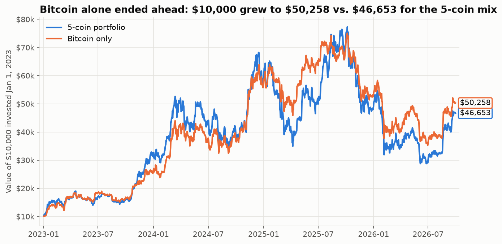
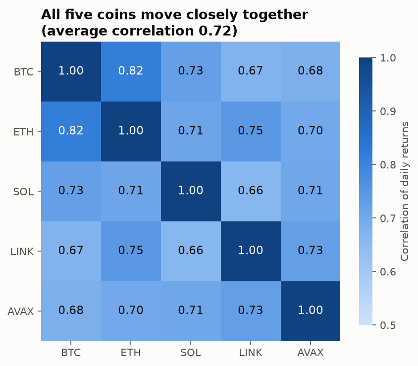
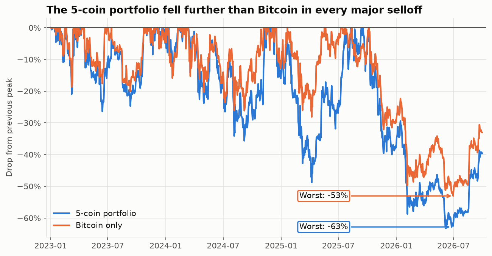

# Crypto Portfolio Risk Dashboard

**Live dashboard:** (link coming soon)

## The question
Does spreading money across 5 coins actually lower risk compared to holding only Bitcoin, and by how much?

## The answer
**No. In this period, the 5-coin portfolio was riskier than Bitcoin alone, and it earned less.**

From Jan 2023 to Sep 2026, the 5-coin portfolio had **56.2% yearly volatility vs. 46.6% for Bitcoin alone**, and a deeper max drawdown (**−62.8% vs. −53.1%**). The coins moved closely together (average correlation **0.72**), and every other coin was more volatile than Bitcoin. Adding them added risk faster than diversification could take it away.

## Key numbers
| Metric | Portfolio | Bitcoin only |
|---|---|---|
| Total return | +367% | +403% |
| Yearly volatility | 56.2% | 46.6% |
| Max drawdown | −62.8% | −53.1% |
| 95% daily VaR | −4.4% | −3.6% |

Portfolio weights: BTC 40%, ETH 30%, SOL 15%, LINK 10%, AVAX 5%.

## Why diversification didn't help
**The coins move together.** When Bitcoin falls, the others fall with it. BTC and ETH have a correlation of 0.82, and no pair is below 0.66.

**The other coins are much riskier than Bitcoin.** Yearly volatility was 47% for BTC, 63% for ETH, and 82–87% for SOL, LINK and AVAX. As a result, the portfolio fell further than Bitcoin in every major selloff.

**Diversification still did something, just not enough.** The portfolio's volatility (56.2%) was about 7 points lower than the weighted average of its coins (63.0%), because the coins don't move in perfect lockstep. That benefit was smaller than the extra risk the smaller coins brought in.

**For a fund manager:** spreading money across these coins doesn't make a crypto allocation safer than Bitcoin alone. Lowering risk would take assets that don't move with crypto at all.

## How I did it
1. Downloaded daily prices for BTC, ETH, SOL, LINK, and AVAX from Yahoo Finance (1,369 days)
2. Checked for missing values, gaps, impossible prices, and extreme moves. The data was complete, so no rows were dropped, and every large move matched a real market event.
3. Wrote a hypothesis before calculating: the mix would be slightly riskier because the coins follow Bitcoin. It was confirmed.
4. Built a weighted portfolio (40/30/15/10/5) and a Bitcoin-only benchmark
5. Calculated volatility, max drawdown, VaR, and correlations for both, side by side
6. Built a Streamlit dashboard so users can test their own weights

The full analysis is in [`notebooks/01_risk_analysis.ipynb`](notebooks/01_risk_analysis.ipynb).

## Data and tools
Yahoo Finance via yfinance · Python (pandas, NumPy, Matplotlib, Altair) · Streamlit

## How to run it
    pip install -r requirements.txt
    streamlit run app/app.py

## Limits
- Assumes the portfolio resets to target weights every day, with no trading fees
- Starts in Jan 2023, near the bottom after the 2022 crash and FTX collapse, so total returns look very large and risk may look lower than it would over a full cycle
- Covers one market cycle with five coins; a different period or coin list could give a different answer
- Past volatility doesn't predict future volatility
